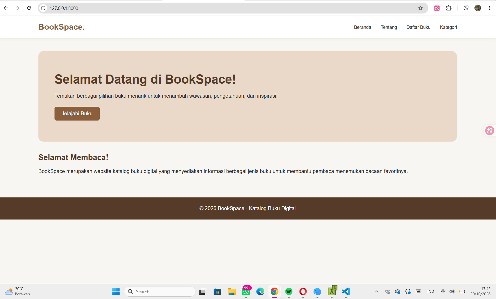
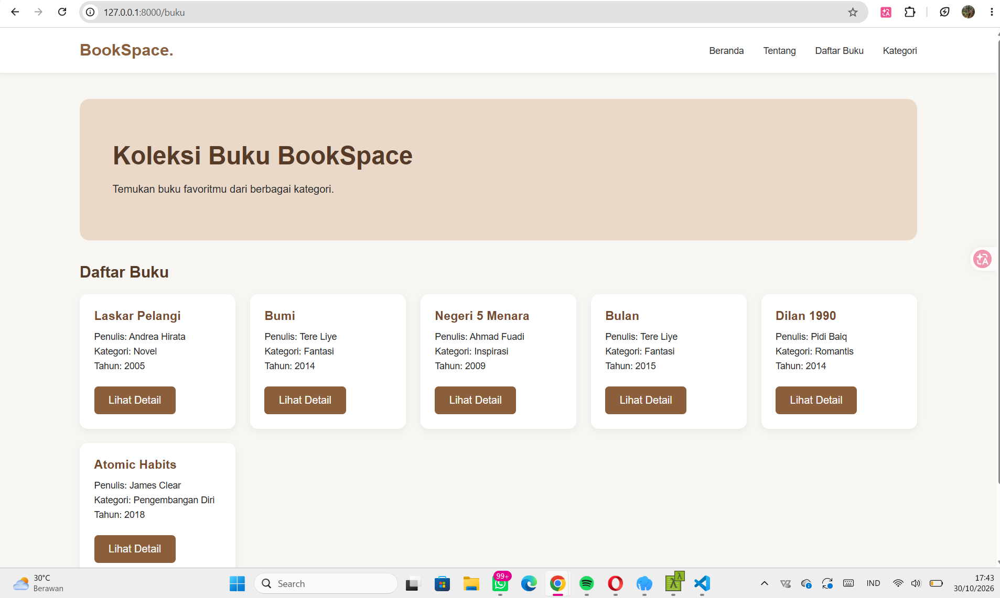

# BOOKSPACE – WEBSITE KATALOG BUKU

## Identitas Mahasiswa
- Nama: Dina Permatasari
- NIM: C2483207009
- Kelas: PTI5A
- Program Studi: S1 Pendidikan Teknologi Informasi
- Judul/Tema: Website Katalog Buku (BookSpace)

## 1. Deskripsi Aplikasi
BookSpace merupakan website katalog buku berbasis Laravel. Website ini dibuat untuk memudahkan pengguna melihat koleksi buku, mengetahui kategori, dan membaca informasi detail buku.

Aplikasi ini memiliki enam koleksi buku dengan kategori Novel, Fantasi, Inspirasi, Romantis, dan Pengembangan Diri.

## 2. Fitur Aplikasi
1. Beranda
2. Tentang BookSpace
3. Daftar Buku
4. Kategori Buku
5. Detail Buku

## 3. Penerapan Routing, Controller, dan View

### A. Routing
Routing berfungsi mengatur alamat URL dan menghubungkannya dengan Controller.

- `/` : Beranda
- `/tentang` : Tentang
- `/buku` : Daftar Buku
- `/kategori` : Kategori Buku
- `/buku/{id}` : Detail Buku

### B. Controller
Controller berfungsi mengatur proses aplikasi dan mengirimkan data ke View.

- HomeController: Mengatur halaman Beranda dan Tentang.
- BukuController: Mengatur daftar buku, kategori, dan detail buku.

Data buku disimpan dalam bentuk array di BukuController.

### C. View
View berfungsi menampilkan informasi kepada pengguna dalam bentuk halaman website.

File View yang digunakan:
- `home/index.blade.php`
- `home/tentang.blade.php`
- `buku/index.blade.php`
- `buku/kategori.blade.php`
- `buku/show.blade.php`
- `layouts/app.blade.php`

View menggunakan Blade Template seperti `@extends`, `@section`, `@yield`, dan `@foreach`.

## 4. Teknologi yang Digunakan
- PHP
- Laravel
- HTML
- CSS
- Blade Template
- Git dan GitHub

## 5. Screenshot Hasil Aplikasi

### A. Halaman Beranda

### B. Halaman Daftar Buku

### C. Halaman Detail Buku

## 6. Cara Menjalankan Proyek
1. Clone repository:
   `git clone https://github.com/dinadinapermatasari91-maker/bookspace.git`

2. Masuk ke folder:
   `cd bookspace`

3. Install dependency:
   `composer install`

4. Salin konfigurasi:
   `copy .env.example .env`

5. Buat application key:
   `php artisan key:generate`

6. Jalankan server:
   `php artisan serve`

7. Buka browser:
   `http://127.0.0.1:8000`

## 7. Repository GitHub
https://github.com/dinadinapermatasari91-maker/bookspace